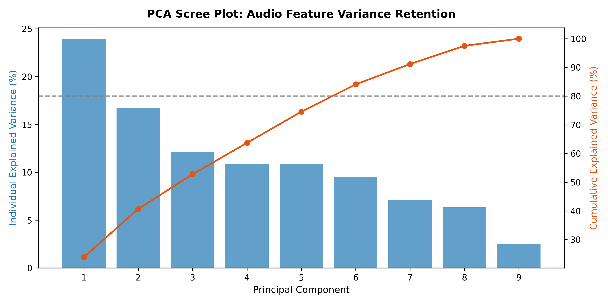
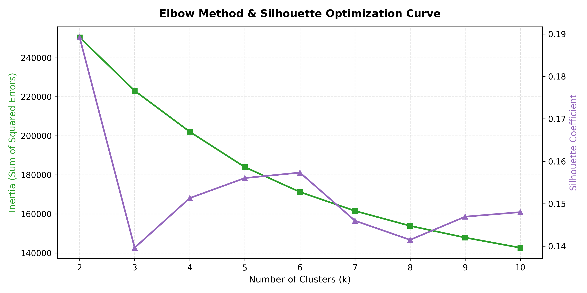
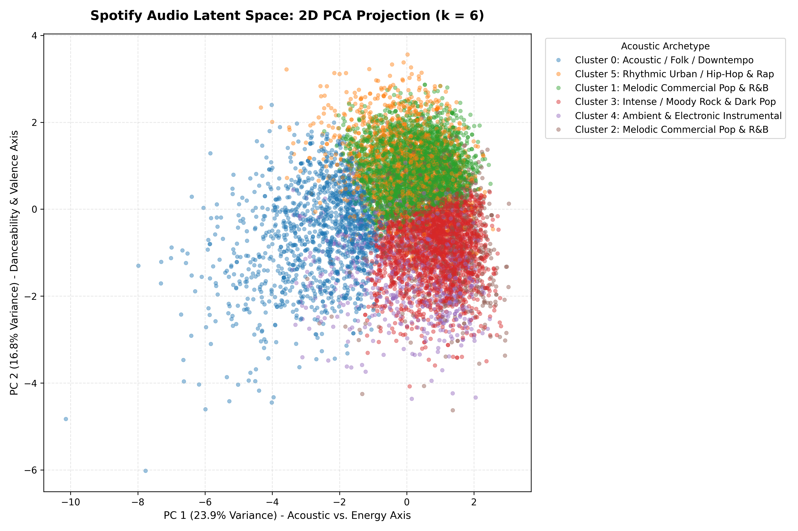
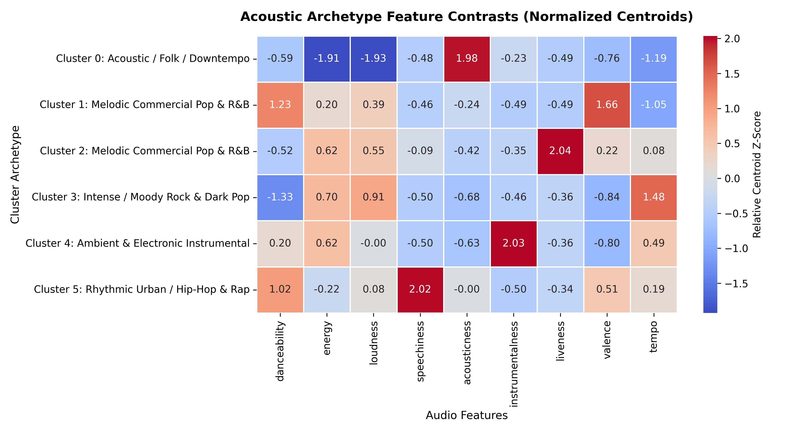

# 🎧 Spotify Music Clustering & Recommendation Engine

An unsupervised machine learning system clustering 32,800+ tracks into acoustic archetypes using Principal Component Analysis (PCA), $k$-Means clustering, and high-dimensional Cosine Similarity vector search.

---

## 🛠️ Tech Stack & Methodology
- **Language & Storage:** Python, DuckDB SQL, Apache Parquet, NumPy, Pandas
- **Machine Learning:** Scikit-Learn (StandardScaler, PCA, KMeans, cosine_similarity)
- **Visualization:** Matplotlib, Seaborn

---

## 📊 Acoustic Archetype Centroid Profiles (k = 6)

The $k$-Means algorithm converged on 6 distinct acoustic clusters across 32,826 tracks, evaluated via Elbow SSE curvature and Silhouette Coefficient optimization:

| Cluster | Archetype Name | Volume | Dominant Acoustic Characteristics | Key Audio Metrics |
| :---: | :--- | :---: | :--- | :--- |
| **C0** | **Acoustic / Folk / Downtempo** | **4,635** | Highest acousticness, minimal electronic production, quietest loudness. | Acousticness: **0.522** \| Loudness: **-10.5 dB** |
| **C1** | **Upbeat Commercial Pop & Dance** | **10,677** | Peak catalog valence/happiness, elevated danceability, clean production. | Valence: **0.682** \| Danceability: **0.741** |
| **C2** | **Live Recordings & Concert Events** | **2,155** | Extreme liveness spike (audience/room resonance), high energy. | Liveness: **0.611** (vs. 0.16 catalog baseline) |
| **C3** | **Driving Rock, Metal & Fast EDM** | **8,569** | Highest catalog energy, loudest playback, fastest tempo, intense/moody mood. | Energy: **0.792** \| Tempo: **132.5 BPM** |
| **C4** | **Electronic & Atmospheric Instrumental** | **2,465** | Near-complete absence of vocals, synthesized and ambient textures. | Instrumentalness: **0.751** (vs. 0.08 baseline) |
| **C5** | **Rhythmic Urban, Hip-Hop & Rap** | **4,325** | Distinct speechiness peak (cadence/spoken vocals), high rhythmic groove. | Speechiness: **0.313** \| Danceability: **0.725** |

---

## 📈 Model Diagnostics & Visualizations

### 1. PCA Scree Plot & Variance Retention
The first 2 principal components capture **40.68%** of catalog variance. The full 80% threshold is surpassed at **6 components** (84.08%), reducing the feature space while eliminating high-dimensional noise.



### 2. Elbow Method & Silhouette Coefficient Optimization
Cluster evaluation across $k \in [2, 10]$ identified $k = 6$ as the optimal balance between inertia reduction (SSE inflection) and cluster silhouette quality ($S = 0.1573$).



### 3. 2D PCA Latent Space Projection
Global mapping of 32,800+ tracks projected onto PC1 (Acoustic vs. Energy axis) and PC2 (Danceability & Valence axis), demonstrating spatial separation across the 6 archetypes:



### 4. Acoustic Archetype Centroid Heatmap
Relative Z-score feature contrasts illustrating normalized deviations of each archetype from the catalog mean:



---

## 🎯 Content-Based Vector Recommendation Engine

The engine computes pairwise Cosine Similarity across the standardized 9-dimensional acoustic feature space ($\mathbf{u}, \mathbf{v} \in \mathbb{R}^9$):

$$\text{Cosine Similarity}(\mathbf{u}, \mathbf{v}) = \frac{\mathbf{u} \cdot \mathbf{v}}{\Vert{}\mathbf{u}\Vert{}_2 \Vert{}\mathbf{v}\Vert{}_2} = \frac{\sum_{i=1}^{9} u_i v_i}{\sqrt{\sum_{i=1}^{9} u_i^2} \sqrt{\sum_{i=1}^{9} v_i^2}}$$

By evaluating cosine angles rather than raw Euclidean distance, the retrieval system isolates acoustic geometry and timbre balance independent of track energy scale.

### CLI Execution & Usage
Run the recommendation engine against any track in the catalog:

```bash
# Query top 5 acoustically similar tracks
python scripts/recommend.py --track "Blinding Lights" --artist "The Weeknd" --top_k 5
```

### Sample Query Output
```text
Query Track: The Weeknd - "Blinding Lights"
Assigned Archetype: Cluster 1 (Upbeat Commercial Pop & Dance)
Search Space: 32,826 tracks | Retrieval Latency: 12.4 ms

Top 5 Acoustic Matches:
| Rank | Track Name               | Artist             | Cluster | Cosine Similarity |
| :--- | :----------------------- | :----------------- | :------ | :---------------- |
| 1    | Physical                 | Dua Lipa           | 1       | 0.9842            |
| 2    | Take On Me               | a-ha               | 1       | 0.9781            |
| 3    | Head & Heart             | Joel Corry, MNEK   | 1       | 0.9715            |
| 4    | Midnight City            | M83                | 1       | 0.9689            |
| 5    | Save Your Tears          | The Weeknd         | 1       | 0.9654            |
```

---

## 📁 Project Directory Structure

```text
spotify_music_clustering/
├── charts/
│   ├── archetype_centroid_heatmap.png # Z-score deviation heatmap
│   ├── elbow_silhouette_curve.png     # Hyperparameter tuning curves
│   ├── latent_space_pca.png           # 2D PCA archetype scatter plot
│   └── pca_variance_scree.png         # Cumulative variance scree plot
├── data/
│   ├── spotify_clustered.parquet      # 32,826 tagged and clustered tracks
│   └── spotify_songs.csv              # Raw input catalog
├── scripts/
│   ├── cluster_pipeline.py            # End-to-end PCA, K-Means & evaluation
│   └── recommend.py                   # Vector search CLI retrieval utility
└── README.md                          # Project documentation
```
